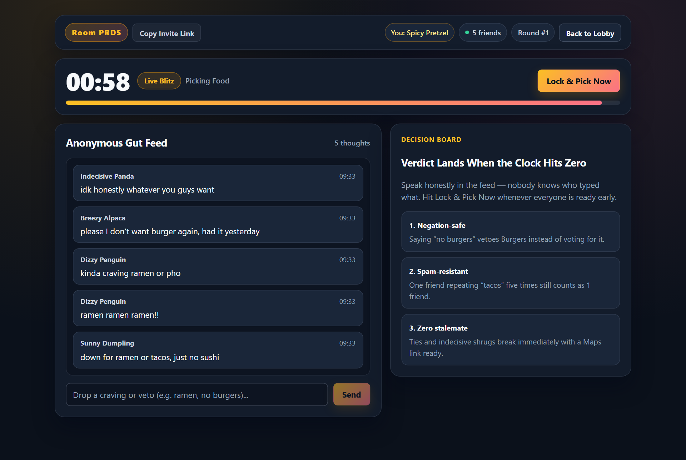
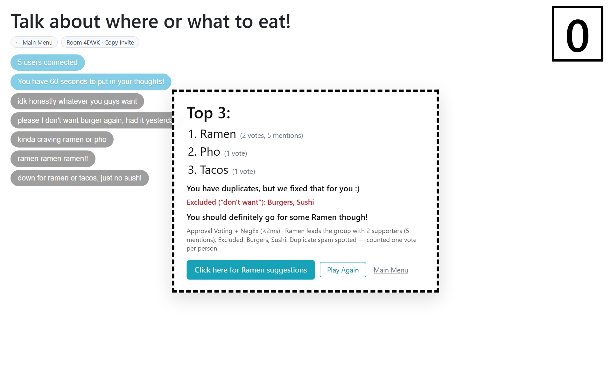
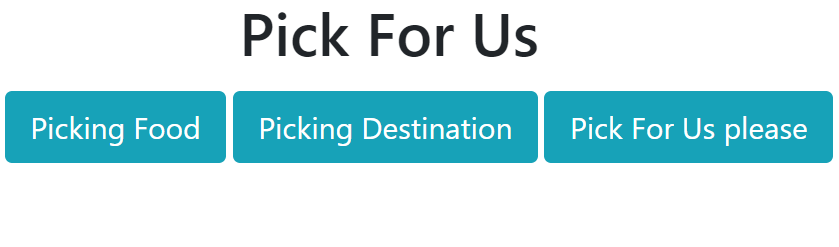
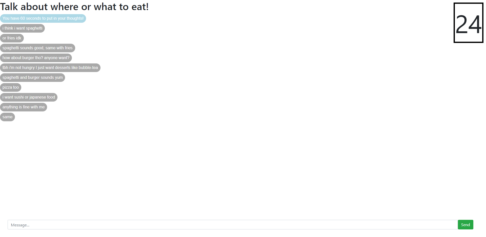
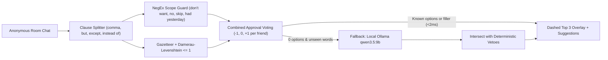

# PickForUs

> **A 2018–2019 anonymous group-chat decision app — preserving the original UI/UX, powered primarily by classical NLP & Approval Voting (no LLM cheating), with local Qwen (`qwen3.5:9b`) strictly as an out-of-dictionary fallback.**

[](LICENSE)
[](package.json)
[](tsconfig.json)
[](docs/RESEARCH-AND-METHODS.md)
[](docs/RESEARCH-AND-METHODS.md)

[Live Walkthrough](#live-walkthrough) · [Same 2019 UI/UX, Improved](#same-2019-uiux-improved) · [The Classical Algorithm](#the-classical-algorithm-no-llm-cheating) · [Quickstart](#quickstart) · [Technical Case Study](docs/RESEARCH-AND-METHODS.md) · [2019 Archive Branch](https://github.com/cnsaavedra/pickforus/tree/v1-2019-archive)

---

Hanging out with friends, everyone is starving, and every message in the group chat is *"idk, whatever you guys want"*?

**PickForUs** turns a chaotic **60-second anonymous blitz chat** into a decisive group verdict. Instead of forcing friends to build a structured poll, everyone dumps raw gut cravings and hard vetoes before politeness stalls the conversation. When the timer hits `0`, PickForUs acts as the group leader: it strips filler chatter, honors exclusions (*"please I don't want burger again"*), collapses single-person spam (*"ramen ramen ramen!!"*), crowns a winner, and opens food or map suggestions.

---

## Live Walkthrough


| 1. Main Menu (`Picking Food` / `Destination` / `Pick For Us`) | 2. Anonymous Pill Feed + Boxed Timer | 3. Centered Dashed `Top 3:` Overlay |
| :---: | :---: | :---: |
|  |  |  |
| Classic white canvas and three `#17a2b8` teal buttons that start a 60s room immediately. | Top-right black-bordered integer timer, sky-blue server pills, grey anonymous bubbles, green `Send` bar. | Centered black-dashed `Top 3:` box honoring `"don't want"` exclusions and spam dedup in `<2ms`. |

---

## Same 2019 UI/UX, Improved

In **October 2018 – May 2019**, PickForUs ([preserved on `v1-2019-archive`](https://github.com/cnsaavedra/pickforus/tree/v1-2019-archive)) pioneered a minimalist three-screen UI around raw natural-language group chat—years before instruction-tuned LLMs existed. The v3 revival keeps that exact UI/UX intact while fixing every underlying engine and transport flaw:

| Screen / Feature | 2019 Original (`v1-2019-archive`) | 2026 Improved (`master`) |
| :--- | :--- | :--- |
| **Main Menu** |  | Preserves the centered white canvas + 3 `#17a2b8` teal buttons; adds shareable 4-letter room join and engine status line. |
| **Chat & Timer** |  | Preserves the top-right black-bordered countdown box, light-blue server pills, anonymous grey chat bubbles, and green `Send` bar; isolates timer + chat per room code (`?room=CODE`). |
| **Results Overlay** |  | Preserves the centered black-dashed `Top 3:` box, `"You have duplicates, but we fixed that for you :)"`, and teal suggestion link; fixes `"topFood"` URL bug and displays `"don't want"` exclusions cleanly. |
| **Decision Engine** | Space-splitter (`length > 3`), broken `"don't want"` handling, leaked `top3[]`. | **Classical Gazetteer + Fuzzy Levenshtein + NegEx Clause Negation + Combined Approval Voting** (`<2ms`), with local Ollama `qwen3.5:9b` strictly as out-of-dictionary fallback. |
| **Persistence** | External `mongodb://localhost:27017` closed after `/get-data`. | Zero-config built-in Node SQLite (`node:sqlite` `DatabaseSync`) isolated per `(room_code, round_number)`. |

---

## The Classical Algorithm (No LLM Cheating)

What 2019 PickForUs was actually trying to build—without an LLM—is a **two-stage classical NLP + Social Choice pipeline** inside [`src/server/extractor.ts`](src/server/extractor.ts):

1. **Gazetteer Phrase Extraction + Damerau-Levenshtein Fuzzy Matching:**
   Matches multi-word and short entities (`bubble-tea`, `rice-bowls`, `pho`, `bbq`, `pie`, `sub`, `tea`) longest-first on word boundaries, plus edit-distance-`<= 1` typo recovery on `>= 5`-letter words (`"spagetti"` -> `Spaghetti`, `"ramne"` -> `Ramen`, `"burgr"` -> `Burgers`) while ignoring conversational stopwords.
2. **NegEx Clause-Scope Negation (Chapman et al., 2001):**
   Segments sentences at punctuation and contrastive conjunctions (`but`, `though`, `except`, `instead of`) so negation triggers (`don't want`, `no`, `skip`, `had ... yesterday`) apply strictly within their clause—meaning `"I don't want burger, maybe pho"` vetoes `Burgers` and votes `+1` for `Pho`.
3. **Combined Approval Voting with Veto (`{-1, 0, +1}`, Brams & Fishburn 1978; Felsenthal 1989):**
   Each participant gets one bounded ternary ballot per candidate across the round:
   - Mentioning `"ramen or tacos"` casts `+1` approval on both (no vote-splitting).
   - Filler like `"idk whatever"` casts `0` (neutral abstention).
   - Spamming `"ramen ramen ramen!!"` is idempotent per `participantId` (max `+1` supporter vote, flagging `You have duplicates, but we fixed that for you :)`).
   - Any `-1` veto disqualifies that option before ranking `Top 3`.
4. **Local LLM Strictly as Fallback:**
   In default `auto` mode, the classical algorithm runs **first** (`<2ms`, zero LLM calls). Local Ollama (`qwen3.5:9b`) is called **only** when a chat produces `0` classical candidates yet contains unrecognized non-stopword terms (e.g., an unlisted restaurant name or slang)—and even then, deterministic vetoes override any unsafe LLM pick.



Read the full mathematical & engineering breakdown in [**`docs/RESEARCH-AND-METHODS.md`**](docs/RESEARCH-AND-METHODS.md).

---

## Quickstart

PickForUs runs **out of the box** with zero external database or `.env` setup required (Node.js `>= 22` provides built-in `node:sqlite`).

### 1. Run Locally (Development or Production)

```bash
npm install
npm run dev
```

Open **`http://localhost:3000`**, click **Picking Food**, and click **Load Demo Chat** (or open a second tab on the copied invite URL) and hit **Finish Now** to see the instant classical decision.

For production build & launch:

```bash
npm run build
npm start
```

On Windows, double-click **`start-pickforus.cmd`** (includes an automatic `PATH` guard if user environment variables exceed `cmd.exe`'s 8191-character limit).

### 2. Optional Fallback & Config Overrides

If [Ollama](https://ollama.com/) is running locally with `qwen3.5:9b` (`ollama pull qwen3.5:9b`), it automatically serves as the out-of-dictionary fallback; otherwise PickForUs runs 100% deterministically. Copy `.env.example` to `.env` to customize:

```env
PORT=3000
PICKFORUS_LLM_MODE=auto        # auto (rules first, LLM fallback) | rules | ollama
OLLAMA_BASE_URL=http://127.0.0.1:11434
OLLAMA_MODEL=qwen3.5:9b
PICKFORUS_DB_PATH=./data/pickforus.sqlite
```

### 3. Verify Everything

```bash
npm run check   # Biome lint/format + strict TypeScript (noUncheckedIndexedAccess)
npm test        # 14 Vitest counterfactual + WebSocket/SQLite integration tests
npm run build   # Vite client bundle + NodeNext server compile
```

---

## Repository History & License

- **`master` (current):** Revived TypeScript / React 19 / `node:sqlite` v3 preserving the 2019 UI/UX on top of the original 2018–2019 commit graph (zero rewritten history).
- **[`v1-2019-archive`](https://github.com/cnsaavedra/pickforus/tree/v1-2019-archive):** Frozen snapshot of the May 2019 prototype (`88641c5`) preserved for historical reference.

Licensed under the [MIT License](LICENSE).
