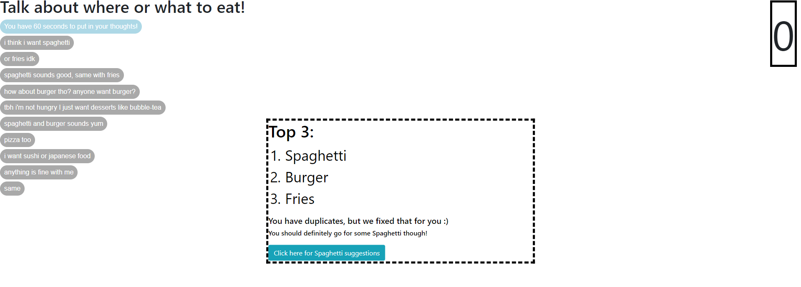
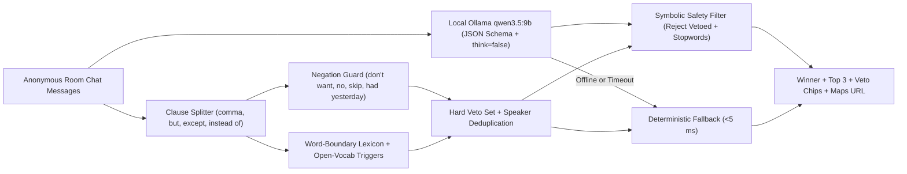

# PickForUs

> **An LLM-style natural-language group decision app conceived in 2018–2019 — four years before modern chat models — rebuilt in 2026 with a hybrid neuro-symbolic + local LLM decision engine.**

[](LICENSE)
[](package.json)
[](tsconfig.json)
[](docs/RESEARCH-AND-METHODS.md)

[Live Walkthrough](#live-walkthrough) · [2019 vs 2026 Evolution](#from-2019-pre-llm-experiment-to-2026-reality) · [Research & Methods](#research--engineering-methods) · [Quickstart](#quickstart) · [Technical Case Study](docs/RESEARCH-AND-METHODS.md) · [2019 Archive Branch](https://github.com/cnsaavedra/pickforus/tree/v1-2019-archive)

---

Hanging out with friends, everyone is starving, and every message in the group chat is *"idk, whatever you guys want"*?

**PickForUs** turns a chaotic **60-second anonymous blitz chat** into a decisive group verdict. Instead of forcing friends to build a structured poll, everyone dumps raw gut cravings and hard vetoes before politeness stalls the conversation. When the clock hits zero, PickForUs becomes the group's decisive leader: it filters filler chatter, honors exclusions (*"please I don't want burger again"*), collapses single-person spam (*"ramen ramen ramen!!"*), crowns a winner, and opens Google Maps.

---

## Live Walkthrough


| 1. Create or Join Room (`Picking Food` / `Destination` / `Pick For Us`) | 2. 60-Second Anonymous Gut Feed | 3. Hybrid Local Qwen Verdict + Vetoes + Maps |
| :---: | :---: | :---: |
|  |  |  |
| Live `/api/health` badge detects local Ollama (`qwen3.5:9b`) or instant rules mode. | Per-tab anonymous aliases (`Dizzy Penguin`, `Breezy Alpaca`) stream in real time over `/ws`. | Honors vetoes (`No Burgers`, `No Sushi`), collapses repeat spam (`2 friends · 5 mentions`), and builds a Maps link. |

---

## From 2019 Pre-LLM Experiment to 2026 Reality

In **October 2018 – May 2019**, PickForUs ([preserved on `v1-2019-archive`](https://github.com/cnsaavedra/pickforus/tree/v1-2019-archive)) tackled a problem that naturally required **Natural Language Understanding** years before instruction-tuned LLMs existed:

- **2019 Original Vision ([`v1-2019-archive` README](https://github.com/cnsaavedra/pickforus/blob/v1-2019-archive/README.md)):** Anonymously collect 60 seconds of free-form friend chat, automatically understand negations (*"I don't want burger"*), catch spam duplicates (*"You have duplicates, but we fixed that for you"*), and suggest the top choice.
- **Why 2019 Broke on Real Chat:** Without LLMs, [`index.js`](https://github.com/cnsaavedra/pickforus/blob/v1-2019-archive/index.js) split messages on spaces (`msg.split(" ")`), discarded every word `<= 3` characters (dropping `pho`, `bbq`, `pie`, `sub`), filtered only 4 stopwords (`want`, `some`, `have`, `test`), had no negation logic (counting `"I don't want burger"` as **+1 for `burger`**), ran a single global timer across sockets, closed MongoDB after round one, and hardcoded `"topFood"` into the Google link.

| Dimension | 2019 Prototype (`v1-2019-archive`) | 2026 Revival (`v3`, current `master`) |
| :--- | :--- | :--- |
| **Lobby & Modes** |  | Shareable 4-letter room codes (`/room/:code`), mode switching, 1-click 4-friend simulator. |
| **Chat & Timer** |  | Isolated per-room `1s` clock, single-flight `1 -> 0` lock, WebSocket + HTTP fallback, round resets. |
| **Decision Engine** | Space splitter (`length > 3`), broken `"don't want"` handling, leaked global `top3[]`. | **Clause-aware negation + per-speaker spam dedup + schema-constrained Ollama `qwen3.5:9b`.** |
| **Verdict Output** |  | Ranked Top 3 (`unique friends` vs `mentions`), veto explanation chips, verified Google Maps search link. |
| **Persistence** | External `mongodb://localhost:27017` closed after `/get-data`. | Zero-config built-in Node SQLite (`node:sqlite` `DatabaseSync`) isolated per `(room_code, round_number)`. |

---

## Research & Engineering Methods

Rather than blindly trusting an unconstrained LLM prompt (which can hallucinate candidates or accidentally crown a vetoed food), PickForUs v3 combines **symbolic linguistic invariants** with **JSON-schema-constrained local LLM inference** inside [`src/server/extractor.ts`](src/server/extractor.ts):



### Core Methods Implemented & Verified

1. **Behavioral Time-Boxing (60s Anonymous Gut Extraction):** Random per-tab aliases (`sessionStorage`) decouple identity from cravings, while the 60-second timer suppresses polite stalemates.
2. **Clause-Level Negation & Short-Token Recovery:** Messages are segmented on punctuation and contrastive conjunctions (`but`, `except`, `though`, `instead of`) before negation cues are tested—so `"I don't want burger, maybe pho"` vetoes `Burgers` while counting `+1` for `Pho` (`\b` boundary matching preserves `pho`, `bbq`, `pie`, `sub`, `tea` without matching `"tea"` inside `"steak"`).
3. **Per-Participant Spam Invariance:** Unique `Set<participantId>` voting caps every participant at `1` positive vote per option while exposing raw `mentions` (`2 friends · 5 mentions`) and flagging spam (`duplicateDetected`).
4. **Constrained Local LLM + Symbolic Guardrail:** In `auto` mode, [`extractWithOllama`](src/server/extractor.ts) calls local `http://127.0.0.1:11434/api/chat` with `stream: false`, `think: false`, a strict `OLLAMA_JSON_SCHEMA`, and a `25000ms` cold-load budget (measured at `~12.1s` cold VRAM load / `~3.4s` warm eval for `qwen3.5:9b`). Output is intersected against the deterministic veto and stopword sets so the model cannot elect an excluded option.
5. **4-Part Counterfactual Verification:** Verified via 13 automated tests ([`tests/extractor.test.ts`](tests/extractor.test.ts), [`tests/server.test.ts`](tests/server.test.ts)) spanning Domain Complement, Sign & Direction Symmetry, `1 -> 0` Single-Flight Edge Locking across 3 concurrent WebSocket clients, and Multi-Round SQLite isolation.

Read the full engineering & methodology writeup in [**`docs/RESEARCH-AND-METHODS.md`**](docs/RESEARCH-AND-METHODS.md).

---

## Quickstart

PickForUs runs **out of the box** with zero external database or `.env` setup required (Node.js `>= 22` provides built-in `node:sqlite`).

### 1. Run Locally (Development or Production)

```bash
npm install
npm run dev
```

Open **`http://localhost:3000`** (single-port server hosting Express REST routes, WebSocket `/ws`, and Vite HMR). Click **Create Room** and then **Load 4-Friend Demo** to test a multi-friend round solo in one click.

For production build & launch:

```bash
npm run build
npm start
```

On Windows, double-click **`start-pickforus.cmd`** (includes an automatic `PATH` guard if user environment variables exceed `cmd.exe`'s 8191-character limit).

### 2. Optional Local LLM & Config Overrides

If [Ollama](https://ollama.com/) is running locally with `qwen3.5:9b` (`ollama pull qwen3.5:9b`), PickForUs detects it automatically via `/api/health`; otherwise it runs seamlessly on the deterministic engine. Copy `.env.example` to `.env` to customize:

```env
PORT=3000
PICKFORUS_LLM_MODE=auto        # auto | ollama | rules
OLLAMA_BASE_URL=http://127.0.0.1:11434
OLLAMA_MODEL=qwen3.5:9b
PICKFORUS_DB_PATH=./data/pickforus.sqlite
```

### 3. Verify Everything

```bash
npm run check   # Biome lint/format + strict TypeScript (noUncheckedIndexedAccess)
npm test        # 13 Vitest counterfactual + WebSocket/SQLite integration tests
npm run build   # Vite client bundle + NodeNext server compile
```

---

## Repository History & License

- **`master` (current):** Revived TypeScript / React 19 / `node:sqlite` / Ollama v3 built cleanly on top of the original 2018–2019 commit graph (zero rewritten history).
- **[`v1-2019-archive`](https://github.com/cnsaavedra/pickforus/tree/v1-2019-archive):** Frozen snapshot of the May 2019 prototype (`88641c5`) preserved for historical reference.

Licensed under the [MIT License](LICENSE).
