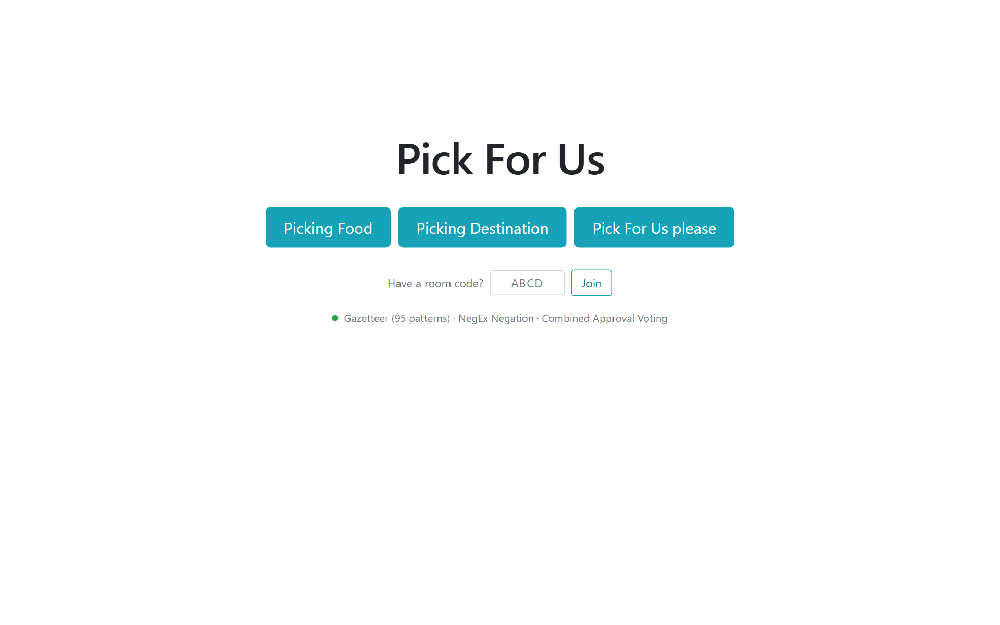
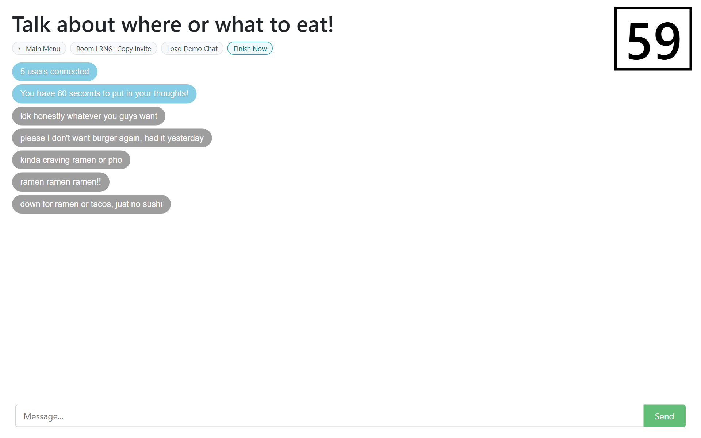
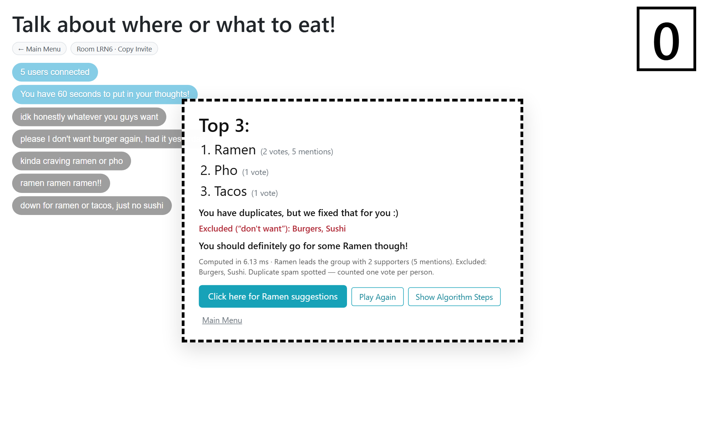
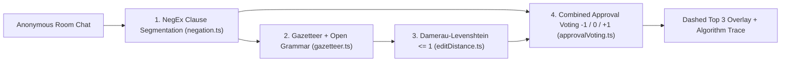

# PickForUs

> **A 60-second anonymous group-chat decision app built with classical NLP and Social Choice algorithms: Gazetteer Phrase Extraction, Damerau-Levenshtein Typo Recovery, NegEx Clause Negation, and Combined Approval Voting.**

[](LICENSE)
[](package.json)
[](tsconfig.json)
[](docs/ALGORITHMS.md)

[Live Walkthrough](#live-walkthrough) · [How It Works](#how-it-works) · [Algorithms & Architecture](#algorithms--architecture) · [Quickstart](#quickstart) · [Algorithm Deep Dive](docs/ALGORITHMS.md)

---

Hanging out with friends, everyone is starving, and every message in the group chat is *"idk, whatever you guys want"*?

Originally created in **October 2018** and upgraded to modern TypeScript, React 19, and built-in Node SQLite (`node:sqlite`), **PickForUs** turns a **60-second anonymous blitz chat** into a clear group verdict. Instead of building a formal poll first, everyone drops honest cravings and hard vetoes before politeness stalls the chat. At `0`, PickForUs strips filler words, enforces exclusions (*"please I don't want burger again"*), collapses repeat spam (*"ramen ramen ramen!!"*), breaks ties fairly, and renders an inspectable step-by-step algorithm trace.

---

## Live Walkthrough


| 1. Main Menu (`Picking Food` / `Destination` / `Pick For Us`) | 2. Anonymous Pill Feed + Boxed Timer | 3. Centered Dashed `Top 3:` Overlay + Trace |
| :---: | :---: | :---: |
|  |  |  |
| Clean white canvas and three `#17a2b8` teal mode buttons, 4-letter room join, and live lexicon count. | Top-right black-bordered integer timer, sky-blue server pills, grey anonymous bubbles, and green `Send` bar. | Centered black-dashed `Top 3:` box honoring `"don't want"` exclusions, spam caps, and **Show Algorithm Steps**. |

---

## How It Works

1. **Pick a Mode or Join a Room** — Start a new session for **Picking Food**, **Picking Destination**, or **Pick For Us please**, or join friends via a 4-letter room code (`?room=CODE`).
2. **60-Second Anonymous Chat** — Everyone sends quick cravings, complaints, and hard vetoes as anonymous grey message pills while the shared room timer counts down to `0`.
3. **Deterministic Group Tally** — When the clock hits zero, the server runs all room messages once through NegEx clause segmentation, word-boundary gazetteer matching, Damerau-Levenshtein typo recovery, and Combined Approval Voting.
4. **Actionable Verdict & Step-by-Step Trace** — A centered black-dashed `Top 3:` card reveals the top choices, a duplicate-spam notice (`"You have duplicates, but we fixed that for you :)"`), excluded vetoes, a direct suggestions link, and a live **Show Algorithm Steps** inspector.

---

## Algorithms & Architecture

Each stage of the decision engine lives in its own focused, readable module under [`src/algorithms/`](src/algorithms/):



- **[`src/algorithms/negation.ts`](src/algorithms/negation.ts) — NegEx Clause-Scope Negation (Chapman et al., 2001):** Splits punctuated sentences, contrastive conjunctions (`but`, `except`, `instead of`), and unpunctuated inline polarity shifts (`"ramen sounds good no sushi"`, `"no burger maybe pho"`) so vetoes only affect their own clause.
- **[`src/algorithms/gazetteer.ts`](src/algorithms/gazetteer.ts) — Longest-Phrase Word-Boundary Gazetteer:** Matches multi-word (`bubble-tea`, `dave & busters`) and short entities (`pho`, `bbq`, `pie`, `sub`, `tea`) without false substring hits (`"steak"` never triggers `"tea"`), plus open preference triggers (`craving X`, `feel like X`).
- **[`src/algorithms/editDistance.ts`](src/algorithms/editDistance.ts) — Damerau-Levenshtein (`<= 1`) Typo Recovery:** Recovers single-edit typos and adjacent character transpositions (`"spagetti"` → `Spaghetti`, `"ramne"` → `Ramen`, `"burgr"` → `Burgers`) on `>= 5`-letter words in `O(min(|a|, |b|))` time.
- **[`src/algorithms/approvalVoting.ts`](src/algorithms/approvalVoting.ts) — Combined Approval Voting (`{-1, 0, +1}`, Brams & Fishburn 1978):** Grants flexible preferences `+1` on multiple options without vote splitting, keeps filler at `0`, caps per-person spam at `+1`, excludes `-1` vetoes, and breaks ties by earliest first mention so spamming never wins a tie.
- **[`src/algorithms/pipeline.ts`](src/algorithms/pipeline.ts) — Explainable Pipeline & Trace:** Captures per-clause polarity, typo fixes, anonymized voter ballots (`Voter #1..#N`), and timing (`durationMs`), inspectable right inside the UI via **Show Algorithm Steps**.

Read the complete worked examples and complexity analysis in [**`docs/ALGORITHMS.md`**](docs/ALGORITHMS.md).

---

## Quickstart

PickForUs runs **out of the box** with zero external database or `.env` setup required (Node.js `>= 22` provides built-in `node:sqlite`).

### 1. Run Locally (Development or Production)

```bash
npm install
npm run dev
```

Open **`http://localhost:3000`**, click **Picking Food**, click **Load Demo Chat** (or open a second browser tab with the copied invite link), and click **Finish Now** to see the verdict and click **Show Algorithm Steps**.

For production build & launch:

```bash
npm run build
npm start
```

On Windows, double-click **`start-pickforus.cmd`** (includes an automatic `PATH` guard if user environment variables exceed `cmd.exe`'s 8191-character limit).

### 2. Optional Environment Overrides

Copy `.env.example` to `.env` if you want to customize the port or database path:

```env
PORT=3000
PICKFORUS_DB_PATH=./data/pickforus.sqlite
```

### 3. Verify Everything

```bash
npm run check   # Biome lint/format + strict TypeScript (noUncheckedIndexedAccess)
npm test        # Vitest algorithm unit tests + WebSocket/SQLite integration suite
npm run build   # Vite client bundle + NodeNext server compile
```

---

## Project History & License

Originally created in **October 2018** as a real-time Express and WebSocket group-decision app, and upgraded to TypeScript 5.8, React 19, Vite 7, Vitest, and built-in `node:sqlite`.

Licensed under the [MIT License](LICENSE).
